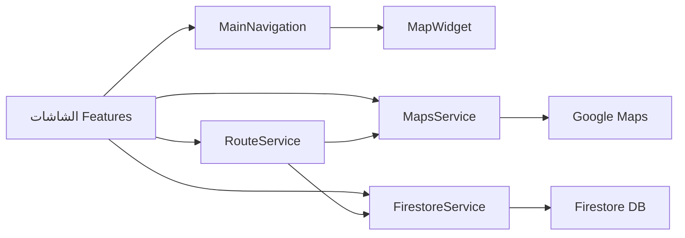

<div align="center">

# 🚌 مواصلاتي — دليل باصات اليمن

**تطبيق Flutter يعرض خطوط الباصات اليمنية على خريطة تفاعلية، ويحدد أقرب الخطوط إلى موقعك، ويخطط المسارات مع محطات التبديل**


</div>

---

## 📖 نظرة عامة

**مواصلاتي** هو تطبيق للهواتف الذكية يساعد سكان اليمن على التنقل بالباصات بكل سهولة. يعرض التطبيق خطوط الباصات على خريطة تفاعلية باستخدام Google Maps، ويحدد خط الباص الأقرب إلى موقعك الحالي، ويساعدك على الوصول إلى وجهتك عبر التخطيط الذكي للمسارات — بما في ذلك المسارات التي تتطلب التبديل بين أكثر من خط.

واجهة التطبيق باللغة العربية بالكامل مع دعم اتجاه RTL، وتصميم مخصص يستهدف المستخدم اليمني.

## ✨ المميزات

| الميزة | الوصف |
|--------|-------|
| 🗺️ **خريطة تفاعلية** | عرض خطوط الباصات على Google Maps مع المعالم والنقاط الرئيسية لكل خط |
| 📍 **تحديد الموقع** | العثور على أقرب خطوط الباص إلى موقعك الحالي باستخدام حساب المسافة الدائرية العظمى (Haversine) |
| 🔄 **تخطيط المسارات** | حساب أفضل مسار إلى وجهتك، مع دعم التبديل بين الخطوط ونقاط التحويل |
| ⭐ **المفضلة** | حفظ الخطوط والمحطات المفضلة لديك للوصول السريع إليها |
| 📡 **فحص الاتصال** | شاشة تحقق من الاتصال بالإنترنت عند بدء التطبيق مع دعم إعادة المحاولة |
| 📱 **توافق شامل** | يعمل على Android وiOS والويب وسطح المكتب (Windows/macOS/Linux) |
| 🌙 **وضعان للعرض** | دعم الوضع الفاتح والداكن مع خط Cairo العربي |

## 📸 لقطات الشاشة

<!-- أضف لقطات شاشة حقيقية من التطبيق: التقط 3-4 صور للشاشات الرئيسية واحفظها في screenshots/ -->

| الشاشة الرئيسية | الخريطة | تخطيط المسار |
|:---:|:---:|:---:|
|  |  |  |

## 🏗️ البنية المعمارية

التطبيق مبني ببنية نظيفة منظمة حسب المميزات (Feature-based architecture):

```
lib/
├── main.dart                      # نقطة الدخول — تهيئة Firebase وdotenv
├── core/
│   ├── constants.dart             # الثوابت المشتركة
│   ├── providers/
│   │   └── theme_provider.dart    # إدارة الثيم (فاتح/داكن)
│   ├── services/
│   │   ├── api_key_service.dart   # إدارة مفتاح خرائط Google
│   │   ├── connectivity_service.dart # مراقبة الاتصال بالإنترنت
│   │   ├── firestore_service.dart    # قراءة بيانات الخطوط من Firestore
│   │   ├── maps_service.dart         # الموقع والحسابات الجغرافية
│   │   └── route_service.dart        # تخطيط المسارات ونقاط التبديل
│   └── widgets/
│       ├── main_navigation.dart   # شريط التنقل السفلي
│       └── map_widget.dart        # مكوّن الخريطة الموحد
└── features/
    ├── home/          🏠 الشاشة الرئيسية
    ├── plan/          🗺️ تخطيط المسار
    ├── favorites/     ⭐ المفضلة
    ├── connectivity/  📡 فحص الاتصال
    └── more/          ℹ️ معلومات أكثر (من نحن، تواصل معنا)
```



### القرارات التقنية

| القرار | السبب |
|--------|-------|
| **Firestore لقراءة البيانات** | تحديث الخطوط لحظياً دون إصدار نسخة جديدة من التطبيق |
| **Provider لإدارة الحالة** | خفيف وبسيط ومناسب لحجم التطبيق |
| **flutter_dotenv للأسرار** | فصل مفاتيح API عن الكود المصدري |
| **Firebase Crashlytics** | تتبع الأخطاء في أجهزة المستخدمين الحقيقية |

## ⚙️ التشغيل محلياً

### المتطلبات

- [Flutter SDK](https://flutter.dev) (3.6+)
- حساب Firebase مع مشروع مفعّل
- مفتاح Google Maps API

### خطوات التشغيل

```bash
# 1. استنساخ المستودع
git clone https://github.com/HashemAlsharee/Mwaslati-.git
cd Mwaslati-

# 2. تثبيت المكتبات
flutter pub get

# 3. إعداد المتغيرات البيئية
cp .env.example .env
# عدّل GOOGLE_MAPS_API_KEY في ملف .env بمفتاحك الخاص

# 4. تشغيل التطبيق
flutter run
```

> ⚠️ **ملاحظة أمان:** لا تشارك أبداً ملف `.env` الحقيقي — الملف `.env.example` يوضح القيم المطلوبة فقط. إن وجدت مفاتيحاً سابقة مسرّبة في تاريخ المستودع، أنشئ مفتاح Google Maps جديداً من [Google Cloud Console](https://console.cloud.google.com) وقيّد استخدامه بمعرّف تطبيقك (Application restrictions).

## 🗂️ دليل الوثائق

| الملف | الوصف |
|-------|-------|
| [BACKEND_INTEGRATION_README.md](BACKEND_INTEGRATION_README.md) | تكامل الخادم الخلفي: الخرائط وFirestore وكشف القرب |
| [FIRESTORE_SAMPLE_DATA.md](FIRESTORE_SAMPLE_DATA.md) | بنية بيانات Firestore المطلوبة لتشغيل التطبيق |
| [GOOGLE_API_SETUP.md](GOOGLE_API_SETUP.md) | خطوات إعداد مفتاح Google Maps API |
| [CONNECTIVITY_SETUP.md](CONNECTIVITY_SETUP.md) | نظام فحص الاتصال بالإنترنت |
| [TRANSFER_ROUTE_IMPROVEMENTS.md](TRANSFER_ROUTE_IMPROVEMENTS.md) | تحسينات خوارزمية المسارات ونقاط التبديل |
| [IMPLEMENTATION_SUMMARY.md](IMPLEMENTATION_SUMMARY.md) | ملخص التنفيذ الكامل للتطبيق |

## 🛣️ خارطة الطريق

> **الحالة:** التطبيق في مرحلة النسخة 1.0.0

| الأولوية | الميزة |
|----------|--------|
| 🔴 عالية | ربط التطبيق بقاعدة بيانات خطوط الباصات الحقيقية |
| 🟡 متوسطة | دعم البحث عن الخطوط والمحطات بالاسم |
| 🟢 منخفضة | إشعارات بأوقات الوصول المتوقعة |

## 👨‍💻 المطور

**هاشم علي الشرعي** — [HashemAlsharee](https://github.com/HashemAlsharee)

## 📄 الترخيص

هذا المشروع مرخّص تحت رخصة [MIT](LICENSE).
